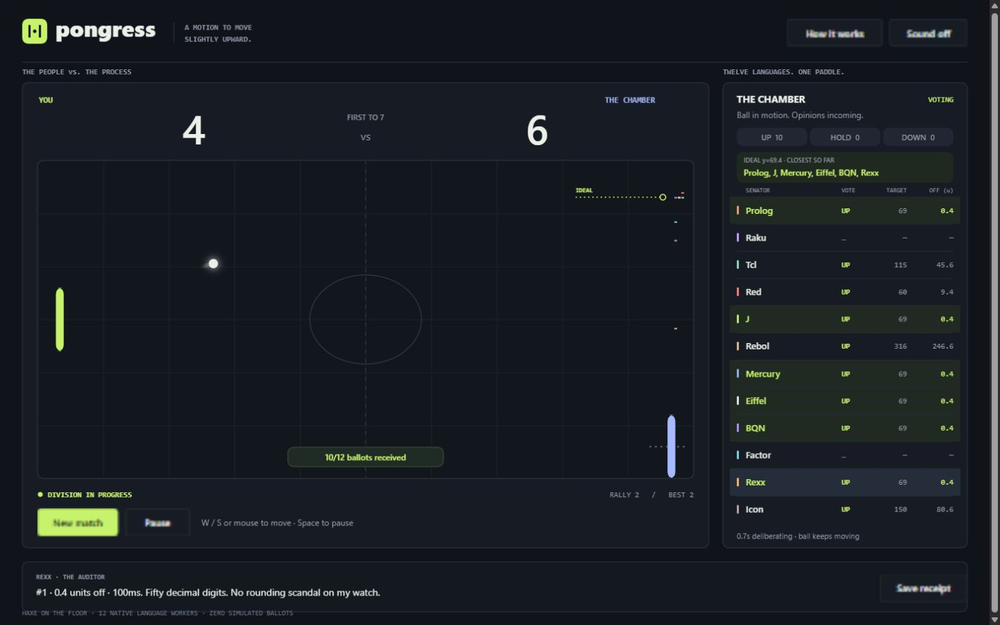

# Pongress

**One paddle. Twelve languages. A motion to move slightly upward.**

Play Pong against a parliament of twelve real native language workers. Each senator proposes a paddle target, Raku counts the division, Eiffel certifies the motion, and Icon writes the proceedings. The ball keeps moving through all of it. Democracy has a deadline.

The interface, game physics, server and tests are written in **Haxe**. The browser script and Node server are compiler output. There are **no handwritten JavaScript files and no CSS stylesheet**; the court and chamber are drawn by Haxe on canvas. A small HTML document loads the application. PowerShell starts/builds the tools, a shell script calls Mercury, and a tiny Python adapter hosts genuine Tcl.



## Play

Supported and tested: **Windows x64**, Node.js 20+, Python 3 with Tcl/Tk, and the same toolchains as [WonkyCalc](https://github.com/Alfredo12111/WonkyCalc).

If WonkyCalc is already set up next to this folder:

```powershell
npm run build
npm start
```

Open **http://localhost:3211/**. After the first build, double-click **Pongress.cmd** to launch a hidden server and open the game. Stop a launcher-started server with:

```powershell
powershell -File scripts/stop.ps1
```

Stop an `npm start` server with Ctrl+C.

For a fresh machine, install Node.js, Python with Tcl/Tk and Visual Studio Build Tools with **Desktop development with C++**, then:

```powershell
npm run setup
npm start
```

Setup reuses an adjacent WonkyCalc installation, or fetches WonkyCalc's pinned toolchain installer into `.cache/toolchains`. The upstream installer verifies pinned archive checksums. First-time setup downloads several gigabytes and builds Mercury; allow substantial time. Toolchain licenses remain those of their upstream projects. Nothing is added permanently to your system PATH.

To use toolchains elsewhere, set `PONGRESS_TOOLCHAINS` to the **.runtimes directory**, or write that path into ignored `toolchains.local.txt`. `PONGRESS_TCL` selects a real tclsh; otherwise the Python/Tcl adapter is used. `PONGRESS_PYTHON` overrides the Python executable. `PORT` changes the HTTP port.

## Controls

- **Mouse / touch:** move or drag on the court to position your paddle.
- **Keyboard:** W/S or Up/Down; Space or P to pause.
- **First to seven** wins. New match resets the score and cancels the previous sitting.
- **Sound** is off initially and can be enabled.
- **Senators:** hover, tap, or focus a language to read its rank, error, execution time and reasoning.
- **Accuracy:** the chamber shows the ideal target and each proposal's distance from it in court units. The closest languages are highlighted; ties share credit. A green IDEAL marker shows the benchmark on the court.
- **Save receipt:** download this match's real snapshots, ballots, timing, accuracy rankings, certified decisions and whether they arrived in time.
- **Post-point inquiry:** explains whether an approved target missed, the paddle arrived too late, or no decision arrived for that shot. Misses with an approved motion record the actual impact height and closest senator.

Switching away from the page pauses the match. The layout stacks the chamber below the court on narrow screens. Reduced-motion preferences disable the ball trail and score flash. Buttons, senator rows, instructions and match announcements have keyboard/screen-reader support; the moving Pong court is visual.

## The chamber

All twelve languages vote in every completed sitting. They do actual strategy work and exchange files in an isolated request directory.

| Senator | Strategy / additional responsibility |
| --- | --- |
| [Prolog](workers/prolog.pl) | Rule-based interception with reflected-wall geometry. |
| [Raku](workers/raku.raku) | A damped forecast; majority tally, tie-breaking and the winning target. |
| [Tcl](workers/tcl.tcl) | A rebound estimate negotiated toward center. |
| [Red](workers/red.red) | An offset interception that tries to produce an angled return. |
| [J](workers/j.ijs) | Closed-form triangular-wave reflection. |
| [Rebol](workers/rebol.reb) | Tracks current ball position and short-term vertical motion. |
| [Mercury](workers/mercury.m) | Typed approach/retreat cases and integer reflection. |
| [Eiffel](workers/eiffel/senator.e) | Bounded interception plus executable quorum and target contracts. |
| [BQN](workers/bqn.bqn) | Five perturbed trajectories and a median forecast. |
| [Factor](workers/factor.factor) | Composes interception with a conservative movement bias. |
| [Rexx](workers/rexx.rexx) | Independently predicts the rebound at 50 decimal digits. |
| [Icon](workers/icon.icn) | A defensive forecast and a report generated from the actual election. |
| [Haxe](src/Main.hx) | The thirteenth source language: rendering, controls, physics and process/HTTP transport. |

Each proposal is classified as UP, HOLD or DOWN relative to the paddle at the start of the sitting. Targets within 24 units of its center vote HOLD. The largest bloc wins. Ties are broken by total confidence, then by the stable preference HOLD, UP, DOWN. Confidence is a fixed strategic weight, not a measured probability.

The upper median target from the winning bloc becomes the motion. HOLD selects the paddle position recorded in the snapshot. Eiffel checks that exactly twelve ballots were counted and that the target remains on the court. Icon then publishes the record. Fifteen real worker invocations are involved: twelve votes, a Raku tally, an Eiffel certificate and an Icon report.

Play continues during every sitting. A serve toward the chamber or a human return requests a vote; while the shot is still approaching, another sitting starts from a fresh snapshot 250 ms after the preceding one finishes. Only one sitting is in progress per browser. Ballots stream into the sidebar as they arrive. The paddle keeps following its existing orders until a new certified decision arrives, then moves toward that target at a limited speed.

Every incoming shot has its own identity. A decision that finishes after its shot reaches the paddle, returns toward the player, or is replaced by a new serve is marked **too late** and saved without moving the paddle. Starting a new match cancels the previous sitting. Manual pause still freezes the court; a failed worker puts the match into recess with a retry action. There is no fake ballot or JavaScript strategy fallback.

Accuracy uses the same integer snapshot given to all twelve workers. Haxe computes the ball's exact reflected trajectory from that snapshot to the chamber's contact plane at x=953, then clamps the ideal paddle center to y=60–540. **OFF (u)** is the absolute distance between a proposal and that legal ideal, in the court's 600-unit coordinate system. Rankings use unrounded errors; the interface displays one decimal place. Equal errors share a rank. During voting, the highlight means closest so far; after all twelve ballots arrive it compares the full chamber. This measures aim, independently of response time or whether the paddle can physically reach the target. The reference calculation only grades proposals; it never controls the paddle.

The three compiled workers are built during setup/build, **not every frame or sitting**. A representative complete sitting took about one second on the development machine; hardware and cold-start timing vary. Slow deliberation can now cost the chamber a point even when its aim is accurate.

## Development

```powershell
npm run build   # Haxe client/server plus native Mercury, Eiffel and Icon
npm test        # Haxe gameplay tests and real native integration checks
```

Tests cover wall/paddle collisions, bounded paddle speed, continuous play during voting, manual pause, rejection of late or obsolete decisions, scoring and restart; reflected accuracy benchmarks, fractional targets and tied rankings; malformed snapshots; three-way ties and confidence tie-breaks; incomplete quorums; Eiffel rejection of illegal targets; reflected intercepts from multiple native workers; simultaneous isolated sittings; and cancellation.

Native programs accept only a bounded numeric snapshot. The Haxe host launches fixed commands without a shell, limits request size, permits two concurrent sittings, caps each worker at 15 seconds, cancels owned process trees on disconnect, and removes per-request files. The server listens only on loopback and rejects foreign Host/Origin values.

**This is a local application, not a deployed public sandbox.** Running the launcher or npm start runs the native workers on the machine where you start it. Public hosting would need a separate supported cloud environment and additional service controls; GitHub Pages cannot execute these workers.

Generated browser JavaScript is marked generated in .gitattributes. Haxe and the recognized worker extensions are explicitly classified. Icon is not currently supported by GitHub Linguist. Language percentages measure bytes of source, not votes or runtime importance.
